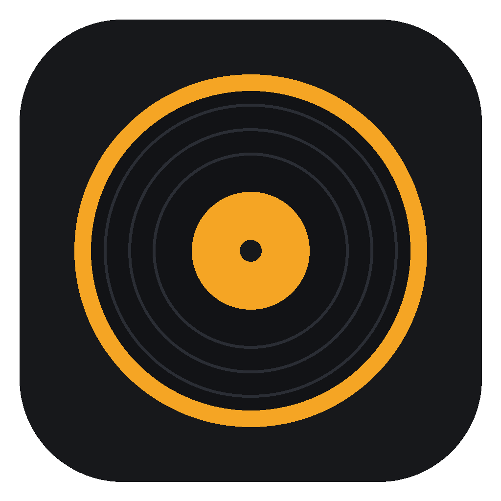

<p align="center">
  
</p>

<h1 align="center">RKB Collection Manager</h1>

<p align="center">
  Organizá tu colección de Rekordbox: listas de temas, metadata, calidad, duplicados, My Tags, eventos y backups.
</p>

<p align="center">
  <b>Versión 0.8 · beta</b> · Mac y Windows · Rekordbox 6 y 7 · GPL-3.0
</p>

---

Una app de escritorio hecha por un DJ para DJs. Trabaja directamente sobre tus archivos de música y sobre la base de datos de Rekordbox, y acompaña todo el camino de un evento: desde la lista que te manda el cliente hasta el chequeo final antes de tocar.

> **Antes de usarla:** hacé un backup de Rekordbox (Archivo → Biblioteca → Hacer copia de seguridad). La app hace su propio backup antes de cada cambio y casi todo se puede deshacer, pero se usa bajo tu propia responsabilidad.

*In English: a desktop tool for DJs that manages a Rekordbox library end to end (client song lists, metadata, audio quality, duplicates, My Tags, played events and backups). The interface is in Spanish.*

## Qué hace

La app está ordenada en cinco pasos:

| Paso | Qué resuelve |
|---|---|
| **1 · Lista de temas** | Pegás la lista del cliente o el link de una playlist de Spotify, YouTube Music o Deezer. La app la compara con tu colección y arma la lista de lo que falta bajar, con links de búsqueda en Beatsource, Beatport, iTunes y Bandcamp. |
| **2 · Descargas** | Analiza los temas nuevos: completa metadata y carátulas, mide la calidad real del audio por espectro y marca los duplicados. |
| **3 · Incorporar** | Mueve los temas a tu colección, los agrega a Rekordbox con su metadata y hace un chequeo de la playlist antes del evento. |
| **4 · My Tags** | Arma las 4 categorías de My Tags de Rekordbox, automáticas desde la metadata o manuales. |
| **5 · Colección** | Navegador con reproductor, edición de metadata de a uno o en lote, «Momento» (Warm Up, Main, Peak, Close) con teclas, sugerencias de temas que siguen bien, duplicados y nombres de archivo prolijos. |

Además:

- **Eventos tocados:** qué pasaste en cada fecha, según el historial de Rekordbox, y qué temas nunca tocaste.
- **Backup y restauración:** copia completa de la base de Rekordbox y de tu música, pensada para un disco externo.
- **Historial:** cada operación guarda su backup y se puede deshacer.
- **Cartelera:** anuncios de eventos, cursos, equipos y búsquedas de DJs de tu zona (opcional, necesita el servidor).

## Requisitos

- **Mac:** chip Apple (M1 o más nuevo), macOS 12 o posterior.
- **Windows:** Windows 10 u 11 de 64 bits.
- **Rekordbox** 6 o 7.

Para guardar cambios en la base, Rekordbox tiene que estar cerrado. La app avisa si está abierto.

## Instalación

Todavía no hay descargas publicadas. Las instrucciones de instalación que acompañan a cada versión están en [`distribucion/`](distribucion/):

- [LEEME Mac](distribucion/LEEME%20Mac.txt)
- [LEEME Windows](distribucion/LEEME%20Windows.txt)

## Correrla desde el código

Hace falta [uv](https://docs.astral.sh/uv/) (o cualquier Python 3.11 o más nuevo).

```bash
uv venv --python 3.13 .venv
uv pip install --python .venv/bin/python pyrekordbox mutagen requests numpy pillow imageio-ffmpeg
.venv/bin/python kramer_app.py
```

Queda corriendo en `http://127.0.0.1:8765`. Para abrirla con ventana propia, como la app armada, sumá `pywebview` y corré `kramer_ventana.py`.

Variables de entorno útiles para desarrollo:

| Variable | Para qué |
|---|---|
| `KRAMER_PUERTO` | Puerto del servidor local (por defecto 8765). |
| `KRAMER_APP_DIR` | Carpeta de configuración de la app, para probar sin tocar la real. |
| `KRAMER_NUBE_URL`, `KRAMER_NUBE_CLAVE` | URL y clave pública de Supabase. Vacías, la Cartelera y el aviso de versión nueva quedan apagados. |

## Armar la app

| Sistema | Cómo | Resultado |
|---|---|---|
| Mac | doble clic en `armar_app.command` | `RKB Collection Manager.app` y un zip para compartir en Descargas |
| Windows | doble clic en `armar_app_windows.bat` | `RKB Collection Manager.exe` y un zip para compartir en Descargas |

Cada sistema se arma en su propia computadora. El script de Mac además instala la app en `/Applications`, reemplazando la versión anterior, y la abre.

## Publicar una versión

No hace falta armar nada a mano: GitHub arma la app para Mac y para Windows y la publica.

1. Subí el número en [`web/version.txt`](web/version.txt) (por ejemplo, de `0.8` a `0.9`) y guardá el cambio en `main`.
2. En GitHub, andá a **Actions → Publicar versión → Run workflow**, tildá «Publicar como versión nueva» y tocá **Run workflow**.
3. En unos minutos la versión aparece en **Releases** con los dos zips. Los botones de descarga del sitio apuntan siempre a la última.

Si corrés el flujo sin tildar la opción, arma la app y deja los zips en esa corrida, sin publicar nada: sirve para probar.

## Cómo está hecha

```
kramer/              motor en Python: servidor local, Rekordbox, metadata, backups
web/                 interfaz (HTML, CSS y JavaScript, sin frameworks)
kramer_ventana.py    entrada de la app armada (ventana propia)
kramer_app.py        entrada en modo servidor, para desarrollo
armar_app*           scripts que arman la app con PyInstaller
supabase.sql         servidor opcional: versión, Cartelera y Mis anuncios
distribucion/        instrucciones de instalación que van con cada versión
```

La app levanta un servidor en `127.0.0.1` y muestra la interfaz en una ventana propia. La base de Rekordbox se lee y se escribe con [pyrekordbox](https://github.com/dylanljones/pyrekordbox).

## Privacidad

Tu colección, tus archivos y tu base de Rekordbox nunca salen de tu computadora. La app se conecta a internet sólo para buscar metadata y carátulas, leer playlists de Spotify, YouTube o Deezer, avisar si hay una versión nueva y mostrar la Cartelera.

## Créditos

- **Guido · KRAMER DJ:** idea, criterios y diseño de la herramienta.
- Programada con la asistencia de **Claude**, el asistente de IA de Anthropic.
- Hecha con pyrekordbox, mutagen, pywebview, PyInstaller, FFmpeg, NumPy, Pillow, Requests y Supabase.
- Datos de MusicBrainz, Cover Art Archive, Wikidata, iTunes Search, Deezer, Last.fm, Discogs, Spotify Web API y YouTube Data API.

## Licencia

Software libre bajo la **GNU GPL versión 3 o posterior** ([texto completo](web/LICENSE.txt)). Se distribuye sin garantía de ningún tipo.

Rekordbox es una marca de AlphaTheta Corporation. Spotify, YouTube, Apple, iTunes y Deezer son marcas de sus respectivos dueños. Esta app es independiente: no está afiliada, patrocinada ni respaldada por ninguna de esas empresas.
